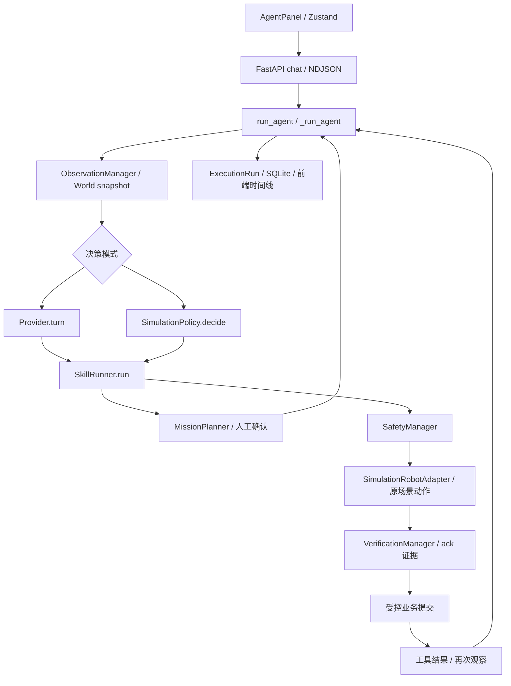

# AgriVerse 茄境智农：项目上下文与持续交接

> 首次接触项目请先读本文件，再按任务阅读下方源码和专题文档。最后核对日期：2026-11-15。本文记录项目当前事实与协作约定；与源码不一致时先核实源码，再更新文档。用户当轮明确要求优先于本文。

## 1. 项目主题与开发优先级

AgriVerse 是面向农业智能体创新竞赛的多角色农业 Agent 原型。温室番茄是当前任务环境，Three.js 植株和机械臂动画是 Skill 的可视化执行载体。

核心方向是 **Agent-First**：

```text
用户目标 → 观察 → 决策 → 选择 Skill → 执行 → 验证
                    ↑                         ↓
                    └──── 更新世界、再次观察 ──┘
```

优先提升任务理解、最新观察驱动的工具选择、结果反馈、重新规划、人工授权、可验证性和持续记录。当前不以继续大规模美化植株、训练视觉模型或连接真实硬件为首要任务。

需要长期保留农户、研学学生、农业专家三种角色，以及采摘、研学选果、专家拨叶观察、环境趋势和报告流程。界面沿用现有自然、克制的绿色风格。

## 2. 仓库与首次阅读顺序

- 公开 GitHub 仓库：[wang-li-wei/AgriVerse](https://github.com/wang-li-wei/AgriVerse)。
- 默认分支：`master`；远程名：`origin`。首次完整上传基线为 `115ad2b`。当前版本以 `git log -1` 和远程实际提交为准。
- 当前主要开发工作区：`/home/wei/文档/ChatGPT/ai农林agent`。其他协作者自行选择克隆位置，不在代码中依赖这个绝对路径。
- 技术栈：React 19、TypeScript、Vite、Three.js、React Three Fiber、Drei、Zustand；Python、FastAPI、Pydantic、httpx、标准库 sqlite3；HTTP + NDJSON。
- 当前 npm 包版本为 `0.1.0`。具体依赖以 [package.json](package.json)、[package-lock.json](package-lock.json)、[后端依赖声明](backend/requirements.txt) 及 [环境锁定记录](backend/requirements.lock.txt) 为准。

建议顺序：

1. 本文件：主题、事实、保护约定、协作方式。
2. [README](README.md)：运行方式和三角色操作流程。
3. [AGENT_ARCHITECTURE](docs/AGENT_ARCHITECTURE.md)：实际架构、持久化和适配器。
4. [AGENT_EXECUTION_FLOW](docs/AGENT_EXECUTION_FLOW.md)：确认、动作、验证和事件。
5. [AGENT_MIGRATION](docs/AGENT_MIGRATION.md)：改造清单、兼容性及历史验证范围。
6. [CONTRIBUTING](CONTRIBUTING.md)：多账号、Fork、分支和 Pull Request。

下一阶段产品体验设计见 [空间智能体工作台审查与方案](docs/design/AGENT_WORKBENCH_REVIEW.md) 和 [可交互线框](docs/design/workbench-wireframes.html)。它们是待实施方案，不代表当前产品已经更换布局；含源码依据、事件映射、Spatial Attention、World Diff、三角色体验与分阶段验收。

早期视觉与执行报告保存在 [PLANT_UPGRADE](docs/PLANT_UPGRADE.md)、[VISUAL_REFINEMENT](docs/VISUAL_REFINEMENT.md)、[EXECUTION_VISIBILITY](docs/EXECUTION_VISIBILITY.md)。它们描述各轮历史交付，不应覆盖当前源码事实。

## 3. 当前能力与模式：必须如实表述

| 项目 | 当前状态 |
| --- | --- |
| 三角色、19 项 Skill、三维温室、采摘与拨叶 | 已实现 |
| 任务、版本化计划、确认恢复、每轮最新上下文 | 已实现 |
| 工具结果回传模型、后续选择工具、有限失败恢复 | 模型调用路径已实现，使用测试 Provider 验证 |
| Responses / 兼容 Chat Completions 原生工具协议 | 已实现，本地 MockTransport 验证 |
| 真实服务商模型在线验收 | 已实测 DeepSeek 模型列表、两轮只读 Tool Calling，以及浏览器 T01 计划/确认/模型执行/场景验证/提交闭环；[接入记录](docs/DEEPSEEK_SETUP.md)；其他模型和硬件未由此验收 |
| 默认离线运行 | `DEMO` / `simulation_policy`，明确标记的规则策略 |
| 感知、成熟度、环境历史、机械臂 | 当前为预置数据与模拟执行 |
| 记忆与恢复 | SQLite 检查点、任务/对话/工具结果/公开事件；不是自动经验学习 |
| YOLO、Gemini Max RGB-D、双腕 RGB、AlohaMini、ROS | 未接入 |
| 通用任务图搜索、向量记忆、自动经验学习、多实例协调 | 未实现 |

`Provider.enabled` 依据配置决定，健康接口的 `REAL_AGENT` 是配置模式标识，不证明远程模型可用。公开交接不包含密钥。当前开发机已在被忽略的本地 `.env` 配置 DeepSeek；克隆仓库的其他账号需要自行配置，不能从 GitHub 获取该凭证。

真实模式中，确认后的任务继续进入模型循环；不再走旧的 `continue_confirmed()` 固定逐果执行器。离线策略仍有有限意图识别和规则分支，不能将其描述成真实大模型自主性。真实 Provider 请求失败不会自动切换成规则策略掩盖失败。

## 4. 实际架构与代码入口



| 文件 / 入口 | 责任与修改时应关注的内容 |
| --- | --- |
| [backend/main.py](backend/main.py) | FastAPI、Session 缓存与恢复、NDJSON、stage/ack、任务/事件/观察 API、执行锁 |
| [backend/agent.py](backend/agent.py)：`run_agent`、`_run_agent`、`completion` | Mission 生命周期、恢复、动态模型循环、最新上下文、工具结果、预算和完成检查 |
| [backend/providers.py](backend/providers.py)：`Provider.turn`、`tool_result` | Responses / 兼容 Chat Completions / DeepSeek；包含 DEMO→Chat 历史转换，不是固定答案模拟器 |
| [backend/models.py](backend/models.py)：`World`、`Mission`、`MissionPlan`、`Session` | 独立世界快照、revision、授权计划、角色历史及运行时状态 |
| [backend/observations.py](backend/observations.py)：`ObservationManager`、`harvestable` | 统一模拟观察、实体关系、资格判断、阶段反馈与来源标记 |
| [backend/missions.py](backend/missions.py)：`MissionPlanner`、`SafetyManager` | 计划版本、确认授权、动作前和提交前校验、步骤结果 |
| [backend/skills.py](backend/skills.py)：`skill_registry`、`tool_definitions`、`SkillRunner.run` | 19 项技能元数据、Schema、权限、超时、实际工具分发 |
| [backend/verification.py](backend/verification.py) | 模拟 Robot Adapter、三态核验、结构化验证失败 |
| [backend/memory.py](backend/memory.py)：`MemoryManager` | SQLite 会话检查点、公开事件、重启恢复 |
| [backend/execution.py](backend/execution.py)：`ExecutionRun.emit` | run_id、seq、时间、任务/步骤/动作关联与事件持久化 |
| [backend/simulation.py](backend/simulation.py) | 明示的离线规则策略；不得冒充真实模型 |
| [backend/roles.py](backend/roles.py) | 三角色提示词和后端工具权限 |
| [src/store.ts](src/store.ts) | 请求、逐条 NDJSON、角色状态、历史恢复、动作 startedAt、stage/ack、重置 |
| [src/components/AgentPanel.tsx](src/components/AgentPanel.tsx) | 对话、确认卡、学生选果及技能日志 |
| [src/components/ExecutionTimeline.tsx](src/components/ExecutionTimeline.tsx) | Mission/版本/阶段、工具参数与结果、折叠记录、失败恢复 |
| [src/scene/SceneMotion.tsx](src/scene/SceneMotion.tsx) | 统一帧时钟、对象/Actor 注册、动作同步、实际场景证据 |
| [src/scene/Robot.tsx](src/scene/Robot.tsx)、[Plants.tsx](src/scene/Plants.tsx) | 机械臂与原果实 Group、复叶、果串及联动 |
| [src/scene/Greenhouse.tsx](src/scene/Greenhouse.tsx) | 温室、场景装配、相机与收集箱 |
| [src/types.ts](src/types.ts) | 前端领域、动作与事件类型；改协议时检查对应后端类型 |

## 5. 状态、协议和失败语义

- `World.snapshot()` 返回可序列化的深拷贝。果实、植株、收集箱、报告或学习状态变化时，指纹检查递增 `world_revision`；重复只读不递增。
- 观察含 `observation_id / world_revision / timestamp / source / is_simulated / entities / relations / summary`。当前来源是 simulation；confidence=1 表示预置数据确定性，不是识别准确率。
- 业务状态、模拟阶段和实际 Three.js 对象变换不同。相机姿态、每个小叶的实时世界坐标没有全部传给后端；未知位置不能编造。
- `mission_id` 可跨请求与确认；`run_id` 对应一次请求执行；`seq` 在该 Run 内递增。事件分页用 SQLite `cursor`，不能用 seq 当作全会话游标。
- 确认保存 `mission_id / plan_id / plan_version / world_revision / kind / targets / role`。授权限定目标范围；扩大范围、版本变化或不确定结果需要重新检查并取得必要确认。
- 每轮只执行模型返回的第一个工具，其余调用返回未执行结果，等待下一轮决策。相同 `call_id` 复用结果，变更参数时拒绝。
- 关键结果为 `SUCCESS / FAILED / UNCERTAIN`。裸 `success=true`、工具正常返回或模型声称完成均不能直接产生已采摘状态。
- `update_fruit_status` 是验证后的内部提交入口。注册名称保留，模型 Schema 隐藏，普通 `SkillRunner.run` 调用也会拒绝。
- 动作前及验证后提交前都校验授权和当前目标。工具错误以结构化结果进入模型历史，允许有限恢复；不能将任意工具失败永久当成任务失败，也不能掩盖最终未完成状态。
- 当前预算为每请求 48 回合、180 秒；Mission 累计最多 64 次工具调用；相同参数连续失败最多执行 2 次；动作回执超时 35 秒。显式恢复会重置部分预算计数，具体以 `run_agent` 为准。
- 断流取消待定动作，保留已提交结果。执行任务的 finally 负责释放会话锁，避免 ASGI 流取消导致锁泄漏。
- 服务重启恢复未完成任务时标为 uncertain，不自动重放动作。任务等待/失败/不确定不能包装为业务成功。
- 完成检查当前覆盖结构化采摘/拨叶计划及查询结束，不是任意自然语言目标的形式化证明。`retrying` 虽在状态类型中定义，尚无独立后台重试调度器。

Zustand 的 `worldRevision` 是场景重置计数，后端 `World.world_revision` 是业务版本。不要把后端每次版本更新变成重建全部三维对象的 key，否则会破坏原对象 UUID 连续性。

## 6. 三角色与 19 个 Skill

| 角色 | 主要流程 |
| --- | --- |
| farmer 农户 | 观察、筛选、采摘确认、验证采摘、生产报告 |
| student 研学学生 | 植物部位与成熟阶段、点击选果、评价、单果确认与体验 |
| expert 农业专家 | 模拟病斑观察、拨叶确认、补充观察、生长/环境/巡检与辅助摘要 |

三角色共享同一个 Session 的世界，但保存各自历史。后端角色权限是声明的演示权限，不是完整账号认证系统。专家采摘不能自动调用农户专属生产报告。

以下全部在 `backend/skills.py` 注册。具体 Schema 以代码及 `GET /api/skills` 为准；参数为空时接收 `{}`。

| 名称 | 参数 | 功能 / 特别约定 |
| --- | --- | --- |
| inspect_greenhouse | 无 | 数量与统一模拟观察 |
| identify_tomatoes | 无 | 当前会话果实列表与模拟观察，非图像检测 |
| select_harvest_targets | 无 | 当前资格过滤及暂缓目标 |
| get_harvest_plan | target_ids | 创建版本化采摘确认计划 |
| play_robot_action | action_type, target_id | 已授权 harvest/reveal，验证后内部提交 |
| update_fruit_status | target_id | 仅内部受控提交，不向模型开放 |
| search_agri_knowledge | query | 本地 JSON 知识检索 |
| generate_farm_report | 无 | 农户生产管理报告 |
| query_crop_status | 无 | 植株、可采、在株与收集统计 |
| query_environment_history | days | 1–7 天预置历史 |
| explain_plant_part | part | 茎秆/叶片/花序/果实讲解和高亮 |
| explain_ripeness_stage | 无 | 三种成熟阶段知识 |
| generate_learning_task | 无 | 等待学生选果 |
| evaluate_student_answer | target_id | 评价选果，正确时生成确认 |
| inspect_plant_health | plant_id | 模拟疑似病斑与遮挡，不返回真实诊断 |
| reveal_occluded_area | 无 | LEAF_01 拨叶确认入口 |
| query_growth_stage | plant_id | 品种与生长阶段 |
| query_inspection_records | plant_id | 预置巡检历史 |
| generate_expert_summary | 无 | 模拟事实、历史、辅助判断、待核实事项 |

资格统一入口为 `harvestable()`：在株、harvestable=true、无遮挡、reachable（缺省 true）、红熟且分数≥0.90。该阈值为演示安全检查，不是农艺标准。顺序不是统一的距离/风险评分：离线策略当前保留数据顺序，模型路径可以根据最新结果选择授权范围内的目标。

## 7. 场景与数据约定

- 主业务植株 `P01`：12 片复叶、128 个小叶、2 个三果 FruitTruss、6 颗业务果实 `T01`–`T06`。
- 稳定叶片 ID 为 `P01_LEAF_01`–`P01_LEAF_12`。`LEAF_01` 是专家任务的疑似病斑区域 ID，不等于遮挡复叶自身 ID。
- 当前遮挡叶是 `P01_LEAF_06`；病叶为 `P01_LEAF_07` 的顶生小叶。拨叶可同时补充 T06 和疑似病斑区域的观察。
- T01/T03/T05 在初始预置状态可采；T02 转色，T04 绿熟。T06 原规则暂缓，拨叶只更新遮挡，不改变其成熟度或自动赋予采摘资格。
- 采摘 9000ms、拨叶 8000ms；时长和阶段标签见 `data/robot_actions.json`。部分运动曲线/时间分界仍在 TypeScript 中，改 JSON 不等于完整改变动画。
- 原 Tomato Group 连续移动、保持 UUID，果梗保留；禁止用删除原果实/创建箱内副本伪装转运。
- 不为每个对象增加独立计时器；动作基于同一个 action.startedAt 和统一 useFrame。
- 未经新任务明确要求，不大规模重做植株、增加几何数量、更换框架或打乱已有页面布局。

| 数据文件 | 真实用途 |
| --- | --- |
| [fruits.json](data/fruits.json) | 初始业务 ID、静止坐标、成熟度、资格和果串关系 |
| [plants.json](data/plants.json) | 品种、生长阶段、模拟疑似病斑与遮挡关系 |
| [plant_structure.json](data/plant_structure.json) | 主茎、复叶、果串、拨叶映射及机器人参考点 |
| [robot_actions.json](data/robot_actions.json) / [harvest_actions.json](data/harvest_actions.json) | 动作时长、阶段和接近偏移 |
| [environment_history.json](data/environment_history.json) / [inspection_records.json](data/inspection_records.json) | 预置历史，非实时传感器 |
| [agriculture_knowledge.json](data/agriculture_knowledge.json) | 本地知识样例 |

初始化后，果实采摘状态和遮挡等由后端 Session World 保存并更新，不是每次都从 JSON 重置。原业务 fruit.position 保留静止坐标；模拟观察会为已采果实给出验证槽位。状态读取不能混淆这两种位置含义。

## 8. 首次运行与配置

需要 Node.js 22+、npm、Python 3.11+。其他机器克隆后不会自动拥有原工作区的 `.tools`、`.venv`、node_modules 或 `.runtime`。

```bash
git clone https://github.com/wang-li-wei/AgriVerse.git
cd AgriVerse
./scripts/start.sh
```

脚本会在缺少时建立虚拟环境并安装依赖。前端 `http://127.0.0.1:5173`，后端 `http://127.0.0.1:8000`，API 文档 `/api/docs`。开发时 Vite 代理 `/api`；生产预览 `./scripts/start.sh --production` 使用 8000 单端口。

分开运行参照 README。原开发环境可将已有 `.tools/bin` 加入 PATH；新机器应安装自己的运行时。不要把它们当作已入库文件。

配置只放本地 `.env`，模板见 [.env.example](.env.example)：

| 变量 | 含义 |
| --- | --- |
| LLM_PROVIDER | demo / openai / compatible / deepseek |
| LLM_BASE_URL | 模型服务基础地址 |
| LLM_MODEL | 服务商支持的模型 ID；DeepSeek 默认 deepseek-flash，其他服务商需明确配置 |
| LLM_API_KEY | 仅后端使用的密钥，不提交或打印 |
| AGRIVERSE_MEMORY_PATH | SQLite 路径，可选，默认 `.runtime/agent.sqlite3` |

模型模式仍使用模拟农业感知与机械臂，不会因为开启模型就变成真实相机/机器人。从 DEMO / Responses 切到 compatible / DeepSeek 时，在请求边界转换公开历史与工具记录，不改写原记录。反向切回 Responses 或其他未验证的协议迁移仍建议新会话。

## 9. 常用 API 与恢复入口

| 接口 | 用途 |
| --- | --- |
| GET /api/health | 配置模式和 Skill 数量，非远程模型健康验收 |
| GET /api/skills | 全部 19 项注册元数据 |
| POST /api/sessions | 创建会话 |
| GET /api/sessions/{sid} | 业务世界快照 |
| POST /api/sessions/{sid}/chat | message、role、可选 confirmation_id / selected_id / mission_id；NDJSON |
| POST /api/sessions/{sid}/actions/{action_id}/stage | 前端实际动画阶段 |
| POST /api/sessions/{sid}/actions/{action_id}/ack | 动作结果与证据 |
| GET /api/sessions/{sid}/observations/latest | 当前模拟观察 |
| GET /api/sessions/{sid}/missions | 任务目录及待确认卡 |
| GET /api/sessions/{sid}/missions/{mission_id} | 指定任务状态和结果 |
| GET /api/sessions/{sid}/events?mission_id=…&after=… | 按 cursor 分页读取公开事件 |
| POST /api/sessions/{sid}/reset | 空闲时重置；执行中返回 409 |

公开事件包括 run_started、observation、decision、tool/tool_call、confirmation、action、action_stage、verification、state、message、run_completed、run_failed，以及传输结束标记 done。只展示公开观察、工具参数/结果和决策摘要，不暴露模型隐藏思维链。

## 10. 存储、证据和当前边界

SQLite 保存 Conversation/Mission/World/Experience 四类记录，实质是轻量检查点和公开事件。Session ID 存在浏览器 sessionStorage；刷新可恢复最近各角色的公开记录和场景，历史动作不重播。丢失 Session ID 时没有账号系统帮忙查找；不同用户的独立 Session 不共享同一真实温室。

进程内会话锁不解决多实例协调；事件与检查点分别提交，尚无完整单事务事件溯源、长期留存清理和历史压缩。浏览器几何回执是当前仿真证据来源，服务端不能独立测量物理分离或真实硬件状态。

历史截图/录屏在 `docs/screenshots/` 和 `docs/evidence/agent-first/`；后者含 [录屏](docs/evidence/agent-first/multi-harvest.webm)、[完成截图](docs/evidence/agent-first/multi-completed.png)、[事件样本](docs/evidence/agent-first/multi-events.json)、[验证范围与校验和](docs/evidence/agent-first/validation.json)。这些是当时保存的模拟证据，不自动证明以后每个版本都通过。

## 11. 验证方式与历史基线

```bash
# 仅在本地确实存在附带 Node 运行时时使用：
export PATH="$PWD/.tools/bin:$PATH"
npm run build
.venv/bin/python -m pytest -q tests/test_agent.py tests/test_missions.py tests/test_providers.py
# 首次浏览器测试需要可用 Chromium：
npx playwright install chromium --only-shell
npm run test
```

- `tests/test_agent.py`：原有角色、确认、状态、失败和 API 行为。
- `tests/test_missions.py`：多轮结果输入、动态重规划、确认后模型循环、权限、版本、三态验证、有限恢复、幂等、检查点与两种模型协议。
- `tests/test_providers.py`：DeepSeek 默认配置、稳定接口、两轮工具协议、历史格式转换、错误和截断结果，不使用真实密钥。
- `scripts/check_model.py`：显式手动执行的真实模型只读检查，最多两次模型请求，无机器人动作。
- `tests/e2e/execution.spec.ts`：实际动画、原对象跟随、实时阶段、拒绝回执、断流、超时。
- `tests/e2e/missions.spec.ts`：刷新、断流后锁释放、同任务恢复和再次确认。
- `tests/e2e/flows.spec.ts`、`plant.spec.ts`：三角色、报告/环境、窄屏、植株、遮挡、重置和回滚。

浏览器回归启动的服务通过 Playwright 配置强制 DEMO，防止本地 DeepSeek 配置触发付费调用；需避免复用现有 REAL_AGENT 服务。

2026-11-15 Agent-First 阶段历史基线：构建成功；后端 38 项通过；完整 E2E 10 项通过。完成态折叠调整后另跑多果专项 1 项通过，决策事实增强后重跑后端 38 项通过。不是声称所有最终微调后又完整跑了一遍 E2E，也不是当前文档更新时重跑的结果。

修改时按影响范围验证：仅文档通常检查链接、事实和 `git diff --check`；业务/状态/协议改动运行相应后端测试；动作或页面改动运行相关浏览器用例及必要构建。任务明确要求全量检查时执行全量。未运行、失败或受环境限制必须如实说明。

## 12. 未来方向与真实扩展位置

未来目标包括主动感知、遮挡处理、双臂协作，以及 YOLO / Gemini Max RGB-D / 双腕 RGB / AlohaMini / LeRobot / ACT / SmolVLA。这些是研究或接入方向，不是已安装、已训练或已接通的能力。

实际接口是：

- `PerceptionAdapter.observe(world) -> Observation`，当前实现为 SimulationPerceptionAdapter。
- `RobotAdapter.execute(session, action, context, emit) -> VerificationResult`，当前实现为 SimulationRobotAdapter。

后续可以通过适配器接真实来源，仍需独立落实坐标、硬件安全、认证与可信验证。规划改造前先检查接口调用处；不要创建大量未被调用的空模块或用新框架重写已完成系统。

## 13. 后续每次修改的交付与 GitHub 同步约定

用户已要求后续项目更新同时同步 GitHub 并更新本文件。这是持续协作约定，不需要为常规提交和推送重复询问。若当轮明确要求只读、暂不提交、暂不发布或指定其他仓库/分支，以当轮要求为准。

1. 开始前检查 `git status`、当前分支、远程和最新提交；同步远程信息。发现他人新提交或未提交改动时先核对，保护已有工作。
2. 根据任务修改实际文件，同时更新本文件涉及的主题、架构、入口、配置、协议、测试、边界或下一步。只有局部更正时更新维护记录即可；新事实不要只留在聊天中。
3. 若运行方式、公共行为或迁移有变化，同时更新 README、CONTRIBUTING 或对应专题文档，避免互相矛盾。
4. 完成适当验证，只选择本次任务文件提交；不夹带他人的未提交草稿、密钥、`.env`、会话数据库、依赖或临时构建输出。公开演示证据需确认不含敏感内容。
5. 在本次工作分支提交并推送到 `origin`；协作任务优先 `codex/<任务名>` 分支与 Pull Request。当前分支已按用户约定直接同步时可沿用，不强制额外审批。推送分支不等于自行合并其他人的 PR。
6. 推送前处理远程差异；不强制推送、不用 reset/clean 丢弃他人工作。遇到冲突先解决并验证，不能覆盖远程提交。
7. 推送后核对远程与本地提交一致。交付说明本次变更、实际验证、分支/commit 和 GitHub 链接；同步失败时说明已完成的本地工作和真实原因，不能宣称上传成功。

本文件的维护重点是让下一个账号或 Agent 直接理解当前项目。避免堆积聊天逐字记录、密钥、过期 commit 状态或无法从代码确认的能力。代码与历史报告冲突时，应给出当前事实与历史范围。

## 14. 维护记录

| 日期 | 内容 | 验证范围 |
| --- | --- | --- |
| 2026-11-15 | 完成空间智能体工作台产品审查、信息架构、三角色/窄屏线框、事件映射与实施计划；仅文档和独立设计资产，未改变生产源码或协议 | 当前页面只读测量；已保存事件顺序核对；设计原型浏览器检查；本地链接/行号及差异检查，未重跑业务测试或调用模型 |
| 2026-11-15 | 接入 DeepSeek Flash，增加稳定接口适配、历史转换、只读连接检查和明确收集箱字段；本地 .env 保存凭证，源码/说明同步 GitHub | 构建成功；后端 46 项；三角色 DEMO 浏览器 1 项；真实 DeepSeek 两轮只读及浏览器 T01 采摘闭环，证据见 DEEPSEEK_SETUP |
| 2026-11-15 | 建立项目主题、真实能力、调用链、19 项 Skill、状态/场景约定、运行/测试与持久化总览；明确后续修改更新 agent.md 并同步 GitHub | 根据当前源码和已保存报告核对；本次仅文档变更，检查链接与差异，不重新声明业务测试通过 |

### DeepSeek 接入补充

新增 `deepseek` Provider、默认官方地址/模型、非 thinking 工具模式、2048 输出上限及稳定端点 Schema 兼容。DeepSeek 返回的推理字段不会进入公开事件或新保存的模型历史。`query_crop_status` 保留 collected，同时新增 basket_count，避免模型误读收集箱统计。Settings 的模型说明已改为确认后继续同一任务决策。

真实浏览器实测已完成同 Mission 的计划、确认、模型选择采摘动作、原 Group 回执及最终提交。当前实际验证与重跑结果见 [DEEPSEEK_SETUP](docs/DEEPSEEK_SETUP.md)；本地 `.env` 密钥禁止进入任何提交、日志、截图或证据。

### 空间智能体工作台设计补充（待实施）

本轮审查基线为 `df95c2a`。当前 UI 仍是 App 的场景/Insights 与右侧 AgentPanel；ExecutionTimeline 只取最后一个 Run，store 的执行记录过滤掉 state/confirmation/action，state 直接覆盖当前 World。不能将设计线框当作已上线能力。

拟实施顺序：事件语义与快照投影 → 常驻场景和独立对话/过程布局 → Mission Trajectory 与唯一授权入口 → 只读 Spatial Attention → 经验证提交的 World Diff → 三角色呈现与回归。沿用现有 Zustand、Mission/NDJSON 和 SceneMotion，不增加模型能力或另一套动作时钟。

特别保护：区分用户检查、Agent 当前关注和历史关联对象；不依赖 DEV 窗口调试对象；未知空间锚点明确不可定位；不把模拟业务遮挡关系当作真实图像感知。`verification progress` 即使 task_verified=true 也可能尚未提交，须匹配最终验证和权威 after；拨叶最终 commit 为 null，不能照搬采摘 commit 判定。历史浏览不覆盖 live world、不重播动作、不更改原果实 UUID。详见上述设计文档与源代码行号。
