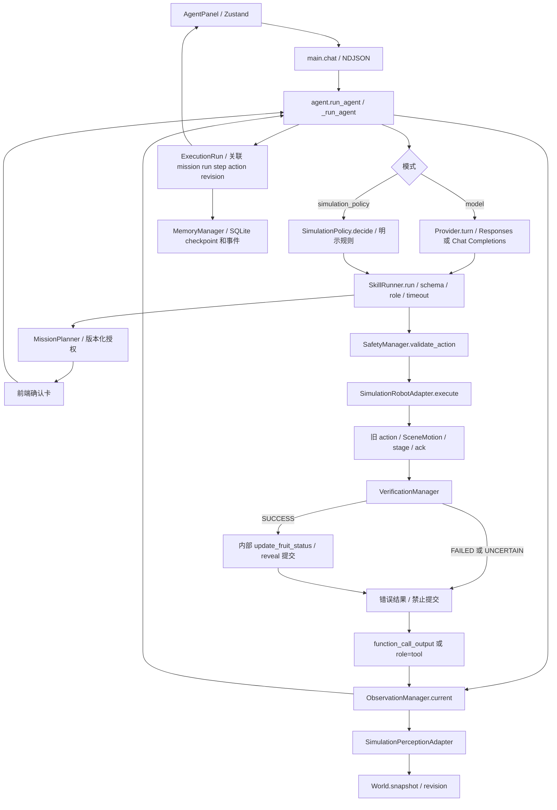

# Agent-First 第一阶段架构

本页描述实际代码路径。感知、机器人、病斑和成熟度均为模拟数据；没有接入 YOLO、RGB-D 或 AlohaMini。默认模拟规则策略不代表大模型自主性。真实模型适配器的网络协议通过 MockTransport 测试，但尚无真实服务商在线验收结果。

## 原问题与替换范围

旧 `agent.py` 在确认后转入 `continue_confirmed()`，按固定 targets 循环执行，绕过 Provider。系统提示中的 World 仅在循环前建立；成功提交工具暴露给模型；World snapshot 引用可变列表；Session 和事件只在进程内；任一工具失败会永久污染 Run 结果。以上路径已替换。

保留 React/Three.js/Zustand/FastAPI、19 个 Skill 名称、三角色权限、旧 NDJSON 类型、动作 UUID、startedAt、35 秒动作超时、9 秒采摘/8 秒拨叶、SceneMotion 注册表、原 Tomato Group、果串和失败回滚。植株代码及模型数据没有改动。

## 实际调用链

## 模块职责

| 模块 | 实际职责 |
| --- | --- |
| `backend/agent.py` | 同一 Mission 的请求/确认/恢复循环；每轮重建状态上下文；结果回传；完成检查；预算和取消 |
| `backend/models.py` | Pydantic Mission/MissionPlan；World 深拷贝快照、变更指纹与 revision；会话运行时 |
| `backend/observations.py` | PerceptionAdapter 协议、模拟实现、不可串改观察；实体图和关系；统一资格规则 |
| `backend/missions.py` | 提议/确认计划、plan_version、动作前后安全校验、步骤结果与重规划记录 |
| `backend/skills.py` | 19 项注册元数据、模型 Schema、权限与参数分发；内部验证提交 |
| `backend/verification.py` | RobotAdapter 协议、模拟动作传输、独立 SUCCESS/FAILED/UNCERTAIN 核验 |
| `backend/memory.py` | 会话、对话上下文、计划、世界、工具结果、经验/错误与公开事件的 SQLite 记录和恢复 |
| `backend/execution.py` | 真实事件顺序、时间、任务关联；工具失败与任务终态分离 |
| `backend/simulation.py` | 离线可解释规则策略；不是 LLM，不以模型失败时自动回退替代真实决策 |

不额外创建没有调用者的 Planner/Router/Manager 空类。工具 Router 即 `SkillRunner.run`；Replanner 由最新观察 → Provider 工具选择 → `MissionPlanner.propose/record` 共同实现。不是独立的搜索规划算法。

## 世界模型和观察

`World.snapshot()` 返回可 JSON 序列化的独立字典；后续改动不会污染旧快照。`refresh_revision()` 根据果实、植株、收集箱、学习、报告状态变更递增版本；重复只读不递增。每次观察具有独立 observation_id、world_revision、UTC 时间、source=simulation、is_simulated=true、实体、关系、摘要。这里 confidence=1 表示预置数据确定性，不是视觉识别准确率。

模拟图包含 Plant、Stem、12 Leaf、128 Leaflet、2 FruitTruss、6 Tomato、Basket、Robot、Camera、Environment、模拟病斑；小叶 ID 与现有组件的命名一致。关系包含 part_of、attached_to、occludes、adjacent_to、reachable_by；执行中可从真实阶段回传补充 held_by，位置未知时返回 null，不伪造实时坐标。果实入箱位置由已验证槽位推导，原 World fruit.position 保留静止坐标以兼容动画。叶片坐标为连接点，不声称测得每个小叶的实时世界变换；Camera 姿态未知，Robot home 是配置值。模拟可达性默认 true，可由模拟观察输入中的 reachable 改变；没有碰撞/工作空间求解。

## Skill 注册和保护

`skill_registry()` 仍返回全部 19 项：description、parameters_schema、required_role、category、side_effect、risk_level、requires_approval、timeout、idempotency、preconditions、postconditions、execution_adapter、internal_only。分类覆盖观察、农艺、计划、操作、验证、教育、报告。`GET /api/skills` 可检查全部元数据。

角色工具 Schema 隐藏 `update_fruit_status`，所以模型最多看到本角色授权的公开工具子集，而非全部 19 项。`SkillRunner.run('update_fruit_status')` 同样拒绝；即使调用 Python 方法，也需内部验证令牌（对应本次已验证 action UUID），不能通过普通工具参数伪造。旧名称保留为内部业务兼容入口。

`play_robot_action` 包含受控执行、验证、内部提交；返回 task_verified、action_uuid、scene_verification、commit。Agent 收到结果后重新观察和决定下一工具。模型不能通过自然语言产生 harvested 状态。

## 授权、计划与安全

确认包含 mission_id、plan_id、plan_version、world_revision、kind、targets、role。确认的是目标范围；Provider 可改变范围内顺序或跳过不满足条件的目标。扩大范围必须创建新版本并确认；任何非执行器自身提交产生的 World revision 变化都会使旧授权失效，这是当前保守策略。

每次动作前与验证后提交前均检查角色、任务、计划版本、世界版本、授权范围、资格、未完成动作和已完成目标。资格统一为 on_plant、harvestable=true、无遮挡、可达、红熟且分数≥0.90；后两项是本轮针对不一致模拟输入增加的保守检查，0.90 为演示安全阈值，不是品种农艺标准；原六颗果实 JSON 的成熟度和资格字段没有修改。模型同批次返回多个工具时只执行第一个，其余返回未执行错误，必须拿到结果后重新决策。相同模型 call_id 缓存结果，参数变化则拒绝；重复 ack、重复确认和已采果实均不能重复提交。

## 任务状态与限制

状态类型：queued、running、waiting_approval、waiting_selection、verifying、success、failed、uncertain、cancelled、retrying。当前实际流程使用前八项及 cancelled；retrying 预留状态值，有限恢复由模型下一轮选工具实现，不是后台自动重试调度器。

单次请求最多 48 个决策回合；Mission 最多 64 个工具调用；请求预算 180 秒；相同参数连续失败最多执行 2 次。预算耗尽以失败终止，不再自动输出成功。每个 Skill 有运行超时，动作仍使用既有 35 秒回执窗口。

完成检查独立于模型文本：待确认/选果是等待状态；授权内仍有可执行目标却结束时标记 uncertain；没有验证采摘不能宣布采摘成功；不确定动作禁止继续操作，需重新确认。已知失败可经新工具结果恢复，不再将任一失败永久等同 Run 失败。

当前完成检查针对结构化采摘/拨叶计划和查询结束，不是任意自然语言目标的形式化证明。专家摘要仍是原演示知识/模板，非模型或视觉诊断。

## 持久化与恢复

默认 `.runtime/agent.sqlite3`（Git 忽略）；可设 `AGRIVERSE_MEMORY_PATH`。标准库 sqlite3，无新依赖。Conversation Memory 保存 Provider 对话上下文；Mission Memory 保存计划/结果/状态；World Memory 保存业务快照；Experience Memory 保存公开事件与失败信息。这些是同一 SQLite 的轻量检查点，不是向量检索或自动经验学习系统。

- `GET /api/sessions/{sid}/observations/latest`：当前模拟观察，含已收到的阶段反馈。
- `GET /api/sessions/{sid}/missions`：任务目录和待确认卡。
- `GET /api/sessions/{sid}/missions/{mid}`：具体任务状态、工具结果与最新观察。
- `GET /api/sessions/{sid}/events?mission_id={mid}&after={cursor}`：按存储游标重放公开事件，最多每页 500 条。
- `POST /api/sessions/{sid}/chat` 的 mission_id：恢复同任务并重新观察、重新取得动作授权。
- 前端刷新恢复最近各角色任务的聊天消息、技能日志和执行时间线；不会重播历史 action。
- 断流取消仍在等待的动作并持久化 cancelled；已提交结果保留。
- 重启发现 running/verifying 等未完成任务时改为 uncertain，撤销待确认/旧授权，不自动补发动作。
- 重置仍在执行时返回 409；空闲重置新世界并保留旧任务记录。

长期模型历史暂未做检索压缩；切换不同原生 Provider 协议时应使用新会话，旧历史的跨协议迁移尚未实现。事件存储和检查点分别提交，尚未实现单事务事件溯源、事件留存清理、跨进程锁或多实例一致性。不能把它当作真实机器人持久化控制平台。

## 未来适配器入口

实际扩展点为 `PerceptionAdapter.observe(world) -> Observation` 和 `RobotAdapter.execute(session, action, context, emit) -> VerificationResult`。YOLO/RGB-D 可实现前者，AlohaMini/ROS 可实现后者；调用者无需依赖 SDK。真实硬件仍需补充独立安全层、坐标标定、身份/并发控制和可信证据验证，本阶段没有相关实现。
