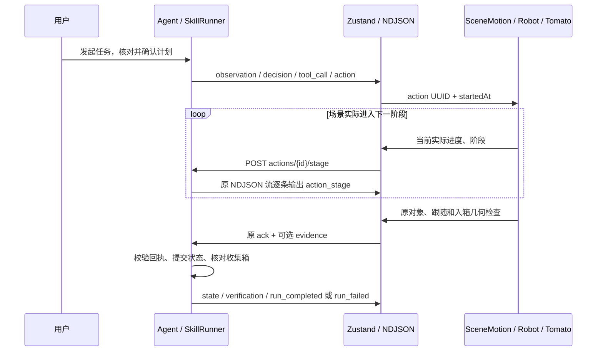

# 执行过程可视化交付

本轮保持 React / Three.js / Zustand / FastAPI，保留 19 个 Skill、三角色、NDJSON、原动作 UUID、`action.startedAt`、原果实 Group 和失败回滚。没有增加依赖。主植株仍为 12 片复叶、128 个小叶、两个 FruitTruss、六颗业务果实；未改果实成熟度、颜色、分数和可采资格。

## 真实根因

原实现不是“后端先提交、前端后播放”。`play_robot_action` 创建 Future，发出 action 后等待 ack；确认成功才允许 `update_fruit_status` 提交。

真正的问题是：

1. 原单果仅 5400ms，运输窗口 `0.54–0.74` 只有约 1.08 秒。分离、转运与放置紧挨着，连续三个目标也没有独立的可见阶段说明。
2. 果实按共享轨迹更新，机器人末端还另做一层逐帧 lerp，产生跟随延迟；机器人在 `0.81` 开始退出，果实到 `0.86` 才落稳。原夹持状态是布尔开关再 damp，没有独立的对准、渐进夹持、释放和验证阶段。
3. Skill 已有 queued/running/success，但执行中的机器人 Skill 只有一条 running；`robot_actions.json` 的阶段名称没有成为实际执行事件。场景 CSS 进度条是独立计时动画，只能看见统一 loading。
4. Detail 取景主要围绕选中的目标；没有把目标、搬运路径、机械臂和箱体一并纳入执行构图。大号白色状态卡还占用场景中下部。
5. 工具调用在每次消息开始清空。快速查询确实会在很短时间内完成，React 可能一次绘制多个最终状态；不能用人为延迟伪造它们的执行时长。
6. 原 ack 主要证明动画时钟走完；没有把原果实 UUID、夹爪跟随误差、最终入箱位置作为新客户端的提交依据。场景动作完成和后端结果验证没有独立展示。

## 执行链与事件

- 每次聊天请求有独立 `run_id`；确认继续执行属于新的运行，仍引用原确认计划。
- 原有事件字段不删改，附加 `run_id`、递增 `seq` 和 UTC ISO `timestamp`。新执行事件包含 `phase`、`target_id`、`tool_name`、`stage`、`status`、可读 `message`、实际 `progress`、结构化 `result` 等适用字段。
- 新增 `run_started`、`observation`、`decision`、`tool_call`、`action_stage`、`verification`、`run_completed`、`run_failed`。
- 阶段由同一个 `startedAt` 的场景帧触发，串行 POST 防止阶段乱序；后端在动作仍有效时将事件写回当前 NDJSON 队列。没有后端 sleep 或独立前端定时器制造进度。
- 进入新阶段，上一实际阶段才记录 completed；任务没有全部结束时，前端已能看到此前的阶段事件。完整事件记录保留 started 与 completed，时间线按阶段合并显示其当前状态。
- 工具名称、参数、开始/结束时间、状态、返回结果与失败原因保留在技能记录中；不再每次消息清空。右侧当前运行时间线保持可见。
- 任务完成总结由本次新增 collected、当前剩余果实和 basket_count 生成。等待确认/学生选择显示“等待你的操作”，不会显示采摘成功。任何执行失败都不会显示“本轮已验证完成”。

## 动作时间与跟随关系

单果默认 **9 秒**，拨叶默认 **8 秒**。所有比例来自 `data/robot_actions.json`，时间线名称与场景阶段共用该文件。

| 采摘阶段 | 区间 | 时间 |
| --- | --- | --- |
| 接近 | 0–0.23 | 2.07s |
| 对准 | 0.23–0.34 | 0.99s |
| 夹持 | 0.34–0.46 | 1.08s |
| 分离、轻提 | 0.46–0.53 | 0.63s |
| 弧线运输 | 0.53–0.75 | 1.98s |
| 开爪、缓冲入箱 | 0.75–0.86 | 0.99s |
| 退出、重新定位 | 0.86–0.96 | 0.90s |
| 场景结果检查 | 0.96–1 | 0.36s |

目标观察和授权决策发生在动作发出前。后端提交验证发生在动画完成回执之后，不包含在这 9 秒的场景时钟中。

- 原 Tomato Group 通过父节点 worldToLocal 补偿运动，保持 UUID，不删除、不缩放、不复制箱内模型。
- 运输使用连续三次贝塞尔路径。机器人夹持点与果实中心共用该轨迹，去掉独立滞后；夹爪平滑闭合/开启，并在释放后才退出。
- 果梗保持在果串上；果梗、果串和相邻叶片继续使用统一 MotionFrame 产生轻微反馈。
- 前端在整个持果窗口采集夹持点与原果实中心的最大误差，最终核对 UUID、分离标记、误差 <0.08、最终箱内误差 <0.025 后才发送 success ack。
- 后端再次检查收到的 evidence（同 UUID、合理箱内坐标和跟随误差），拒绝不一致的提交；然后执行原更新 Skill，并独立验证业务状态和箱内登记。旧 `{success: boolean}` ack 保持兼容；新客户端始终附带证据。
- 拨叶：接近 → 接触 → 偏转/邻叶微动 → 保持 → 补充观察 → 退出 → 验证。成功后再次调用 `inspect_plant_health`；返回 `diagnosis: null`，模拟病斑待专家核实。拨叶不是识别模型。

## 目标顺序与自主能力边界

当前 DEMO 的工具编排仍为预设流程。目标列表由 `eligible()` 基于当前 harvestable、occluded、on_plant 状态筛选，按场景数据顺序形成；它并非在代码中硬编码 T01→T03→T05。默认数据恰好得到该顺序。

用户确认后按该次清单固定执行，每颗重新校验资格；不会在执行中擅自加入新目标、重排授权清单或自主重规划。真实模型适配器可选择已有 Skill，但确认后的动作仍受相同授权约束。新增事件只是为将来的观察—决策循环提供事实记录，不声称已经实现视觉识别、自主规划或模型内在推理可视化。

## 修改文件

| 文件 | 修改 |
| --- | --- |
| `backend/execution.py`（新增） | 统一运行 ID、事件序号、时间戳和公开工具执行事件 |
| `backend/agent.py` | 运行生命周期、确认计划决策摘要、动态结果总结、拨叶后再次观察 |
| `backend/skills.py` | 真实观察/决策/验证事件、动作上下文、9s/8s 参数、失败清理；保留原 Skill 名称与权限 |
| `backend/main.py` | 兼容的阶段上报端点、原 ack 附加证据校验，仍经 NDJSON 推送 |
| `backend/models.py` | 可选回执证据、阶段请求模型和会话动作上下文 |
| `data/robot_actions.json` | 阶段名称、真实进度边界、时长，保留旧字段 |
| `src/types.ts` | 新事件、运行与回执证据类型，兼容原协议 |
| `src/store.ts` | 逐条记录事件、保留工具历史、串行阶段上报、进度与失败/断流处理 |
| `src/scene/actionStages.ts`（新增） | 前后端共享阶段配置的前端读取 |
| `src/scene/SceneMotion.tsx` | 在既有控制器中加入阶段采集与结果检查，不替换对象表和时钟 |
| `src/scene/Robot.tsx` | 同轨迹持果约束、渐进夹持/释放、完整退出时段 |
| `src/scene/Plants.tsx` | 对齐分离和果梗响应阶段，保持原果实运动方式与组织 |
| `src/scene/Greenhouse.tsx` | 执行过程取景，涵盖机器人、目标和收集箱 |
| `src/scene/geometry.ts` | 仅柔化模拟病斑外围过渡，无植株数量或组织改动 |
| `src/components/ExecutionTimeline.tsx`（新增） | 右侧当前任务、目标、阶段、事实时间线与实际结果 |
| `src/components/AgentPanel.tsx` | 接入时间线，保留技能详情并显示开始/结束时间 |
| `src/components/ScenePanel.tsx`、`src/styles.css` | 小型动作提示及实际进度，避免中心大卡片遮挡 |
| `tests/test_agent.py` | 流式事件顺序、提交前等待、动态目标、技能异常、取消与回执拒绝 |
| `tests/e2e/execution.spec.ts`（新增） | 实际单果/多果/拨叶录制，流式阶段、原 UUID、跟随约束及失败注入 |
| `playwright.config.ts`、`package.json` | 完整流程的测试时限；新增 `npm run test` 入口，保留 test:e2e |
| README / 本文件 / `docs/screenshots/execution/` | 交付与运行证据 |

## 实际运行证据

- [单果全过程录像](screenshots/execution/single.mp4)：研学学生选择 T01，完整采摘与入箱；包含一次运行中禁止重置的检查。
- [多果全过程录像](screenshots/execution/multi.mp4)：T01、T03、T05 分别接近、夹持、分离、转运、释放、退出和验证。
- [拨叶全过程录像](screenshots/execution/reveal.mp4)：偏转、邻叶响应、保持、退出与随后再次观察。
- [单果运输](screenshots/execution/single-transport.png) / [单果最终结果](screenshots/execution/single-complete.png)。
- [多果运输](screenshots/execution/multi-transport.png) / [三果最终入箱结果](screenshots/execution/multi-complete.png)。
- [拨叶保持](screenshots/execution/reveal-hold.png) / [补充观察完成](screenshots/execution/reveal-complete.png)。
- 实际接收的公开执行事件：[单果](screenshots/execution/single-events.json)、[多果](screenshots/execution/multi-events.json)、[拨叶](screenshots/execution/reveal-events.json)。可直接核对 run_id、seq、时间戳和验证证据；不是补写的步骤清单。

新浏览器的正常采摘验证记录中，原 fruit_uuid 与 original_uuid 相同，最终位置为对应箱内槽位；程序化夹持约束的误差接近浮点计算精度。这仅证明本次模拟场景一致，不代表真实机械臂定位精度。

## 最终测试结果

| 命令 / 检查 | 实际结果 |
| --- | --- |
| `npm run build` | 成功，2561 个模块；无新增依赖；开发检查器未进入生产包 |
| `.venv/bin/python -m pytest -q tests/test_agent.py` | **15 passed**；仅第三方 TestClient 弃用提示 |
| `npm run test` | **9 passed，约 5.7 分钟**；全部使用实际浏览器和正常动画时钟 |
| 单果 / 多果 | 原 UUID 不变；实际夹爪点与果实中心误差 <0.04；目标逐个产生八个动作阶段；入箱、后端提交和验证事件之后才结束运行 |
| 拨叶 | 叶片与邻叶运动；保持后退出；重新观察事件晚于动作验证，diagnosis 为空 |
| Skill 执行异常 | 实际执行异常处理路径，run_failed，无果实提交 |
| 回执证据被拒绝 | 浏览器发送错误箱位，后端 409 拒绝，原果实回滚、收集箱不增加、运行失败 |
| 真实超时 | 阻断 ack 到达后端，真实等待约 35 秒；不能把箱内动画当成成功，业务保持未采摘 |
| 断流 | 对照断流前已提交清单；当前目标不提交，已完成目标保留，界面显示未成功 |
| 执行中重置 | 前端按钮禁用，直接 API 请求返回 409；动作继续，不清空执行状态 |
| 果梗保留专项运行检查 | 单果完成后，T01_PEDICEL Group 与其管道 Mesh 的 UUID 均与采摘前相同；管道仍可见，147 个顶点；实际浏览器读取验证 |
| 原有回归 | 农户、学生、专家完整流程；报告、历史趋势、窄屏；三视角真实遮挡、重置、false ack 回滚均通过 |

新增 E2E 直接读取既有开发态场景检查器中的实际状态，避免热更新开发环境中重新导入 Zustand 模块导致检查另一个 Store 实例。此检查器只读，并在生产构建中剔除。

## 当前限制

- 观察来自预置场景字段和 Three.js 几何验证，不是图像识别或真实传感器。病斑是模拟外观，不能诊断。
- 机械臂仍为程序化运动学展示，没有真实物理、逆运动学、力控或自动避碰；跟随证据验证的是程序化场景。
- 浏览器证据不是可信硬件签名，兼容的旧 ack 不携带几何证据；不能据此连接真实作业设备。
- 当前执行记录在前端内存中，按角色保留最多 600 条执行事件；无持久审计库或刷新后恢复时间线功能。服务器重启仍清空演示会话。
- 页面需保持前台。严重卡顿或后台节流可能跳过可见阶段或触发真实超时；没有用补播历史步骤冒充实时执行。
- 没有实现真正的自主感知、开放规划或失败后自主重试；不显示隐藏思维链。
